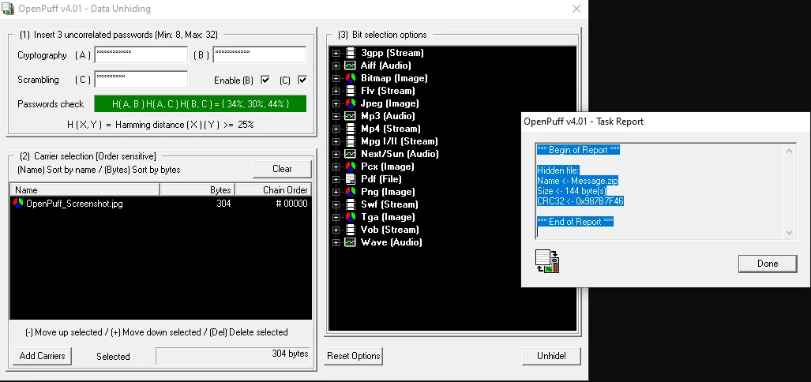

# CSIA 105 Introduction to Cyber Security

Introduction to Cyber Security followed the CompTIA Security+ SY0-701 textbook: cryptography and certificates, endpoint and mobile security, identity, wireless, vulnerability management, forensics and policy. The [Security+ exam](../credentials/index.md#certifications) was passed in May 2026.

## What the course provided and what was submitted {#what-the-course-provided}

The textbook provided each hands-on and case project: the numbered steps, the questions and the download links. The class provided a Windows 10 virtual machine. The submitted work:

- Ran the tools in the VM, or on a physical computer when a project needed real hardware such as a wireless adapter
- Answered each project's questions in his own words, with screenshots
- Wrote the case projects: comparisons of fuzzers and password managers, a presentation on encryption options, and short papers on policy, cyber insurance and the field

## Strongest work {#strongest-work}

### Grading TLS on servers and browsers (4-1) {#grading-tls}

Three sites went through Qualys SSL Labs, and the answers explain each grade:

- **Dropbox's API server:** A+, with TLS 1.3 and 1.2, a trusted 2048-bit RSA certificate and scores of 100, 100, 90 and 90 for certificate, protocol, key exchange and cipher strength. The only marks against it were a few weak TLS 1.2 cipher suites. "It received an A+ because it supports TLS 1.3, It has a secure and trusted certificate."
- **A site from SSL Labs' list of recent worst grades:** F, for insecure protocols, weak cipher suites and the POODLE vulnerability.
- **The college's website:** A+, with TLS 1.3, HSTS and secure cipher suites.

For Dropbox the write-up suggested dropping TLS 1.2 and putting `TLS_AES_256_GCM_SHA384` first in the suite order. In the browser test, Edge and Brave scored the same. The screenshots of Edge show TLS 1.2 and 1.3 only, no CurveBall, Logjam, FREAK or POODLE vulnerability, and a few weak cipher suites still offered.

### Hiding a file in an image (3-1) {#hiding-a-file-in-an-image}

A small zip file went into a JPEG with OpenPuff, behind three passwords, and came back out with the unhide step. The task report shows the recovered `Message.zip` at 144 bytes, and the zip still held its text file. The image looked the same afterward: "Nothing is different from the appearance of the photo, but the file size of the carrier file is slightly different the original is 106,246 bytes and the carrier is 106,238 bytes."

<figure class="evidence-figure">
  

    
  

  <figcaption>From the 3-1 submission, January 25, 2026, cropped to the OpenPuff windows. The Bytes column is the carrier's hiding capacity, not its file size. <a href="../../assets/evidence/csia-105/openpuff-unhide-2026-01-25.webp">Open full size</a>.</figcaption>
</figure>

### Controlling Wi-Fi from the command line (10-4)

This project needed a real wireless adapter, so it ran in an administrator PowerShell window on a physical computer. The textbook gave the `netsh wlan` commands, and the answers cover what each showed:

- `show drivers` reported an 802.11ax adapter that supports both WPA2-Personal and WPA3-Personal.
- After `add filter permission=block` for a nearby network, it disappeared from `show networks`. With `set blockednetworks display=show` it came back in the list with an X in the system tray, and `delete filter` removed the block.
- `show wlanreport` built an HTML report of connection sessions. "This information can be helpful by giving you connection events and how long a client stayed connected to a specific network."

The screenshots show his own and nearby networks, so this page leaves them out.

### Finding deleted data in slack space (13-3)

Directory Snoop's NTFS module showed the drive's master file table and a document's raw text; a slack-space search for the word "country" then found three hits in deleted entries. The write-up explains that the tool can find the data because the deleted entries are still referenced on disk, which is what makes recovery useful in forensics.

## Labs {#labs}

### Cryptography and certificates

| Lab | What it asked | Work done |
|---|---|---|
| 3-1 Using OpenPuff Steganography | Hide a file inside an image and recover it | Hid a zip file in a JPEG behind three passwords, recovered it and compared the file sizes (see above) |
| 3-8 Software Data Encryption | Present encryption options to a fictional firm | Built a 10-slide deck on encryption software, full-disk encryption, self-encrypting drives, HSMs and TPMs |
| 4-1 Trending Cyber | Suggest precautions against losing encryption keys | Recommended a password manager, regular password changes and MFA with a hardware token |
| 4-1 SSL Server and Browser Tests | Grade servers and browsers with Qualys SSL Labs | Graded three sites and two browsers and explained each grade (see above) |
| 4-3 Viewing CRLs and Untrusted Certificates | Inspect trusted roots, a revocation list and untrusted certificates | Read a certificate revocation list and the untrusted store in the Certificates snap-in |

### Endpoints and mobile

| Lab | What it asked | Work done |
|---|---|---|
| 5-1 Microsoft Safety Scanner | Run a quick malware scan | Ran the scan, which found no threats |
| 5-3 Configuring Microsoft Windows Security | Compare Defender protection presets | Compared what the Default, High and Max presets change |
| 5-7 Using a Software Keylogger | See what a keylogger captures | Ran a keylogger trial offline in the VM and explained how an attacker would use its log of the session's typing and browsing |
| 6-1 Creating and Using QR Codes | Show how QR codes can be abused | Made and decoded QR codes and described Wi-Fi, payment and file-download abuse |
| 6-3 Installing NoxPlayer Android Emulator | Run an Android emulator | Installed the emulator and changed its resolution |
| 6-4 Fuzzers | Compare three fuzzers | Compared Burp Suite, OWASP ZAP and Wfuzz in a table and recommended ZAP |

### Identity and wireless

| Lab | What it asked | Work done |
|---|---|---|
| Virtual machine setup | Set up the class's Windows VM | Set up the Windows 10 VM in VirtualBox |
| 7-1 Trending Cyber | Take a position on digital-legacy contacts | Wrote a policy position covering identity checks and how the feature could be abused |
| 7-9 Password Managers | Compare four password managers | Compared Google Password Manager, LastPass, KeePass and Bitwarden on nine points and ranked them |
| 8-3 MAC Spoofing | Change a network adapter's MAC address | Opened a MAC address changer on the VM's adapter and explained the OUI and how attackers use spoofing |
| 10-1 Using a Wireless Monitor Tool | Inspect nearby Wi-Fi networks | Answered questions on hidden SSIDs, channel overlap, WPS and security settings |
| 10-4 Using Microsoft Windows Netsh Commands | Query and control Wi-Fi from the command line | Read the adapter's capabilities, blocked and unblocked a network and generated a wireless report (see above) |

### Vulnerabilities, forensics and policy

| Lab | What it asked | Work done |
|---|---|---|
| 12-1 Exploring CVE | Search the CVE list | Searched cve.org for "passwords" (2,847 results) and answered the questions |
| 12-2 Exploring the NVD | Compare CVE with NVD and explore NVD's data | Explained how CVE and NVD differ, read the score distribution and searched by keyword |
| 13-3 Viewing Windows Hidden Data | Find deleted and slack-space data | Searched slack space with Directory Snoop and found three hits in deleted entries (see above) |
| 15-1 Backups | Schedule a cloud backup | Scheduled a backup with iDrive; the first run had no files selected |
| 15-2 Journaling | Set up sync and real-time backup | Set up sync and real-time protection in iDrive and answered the questions |
| Additional readings | Summarize ethics principles and change control | Summarized eight ethics principles and six benefits of change control |
| 15-11 Cybersecurity Insurance for Users | Weigh personal cyber insurance | Listed four pros and four cons and made a recommendation |
| 15-13 Overview of Information Security | Reflect on the field | Wrote about the CIA triad and AAA, the topics that came as a surprise, and career goals in the field |

## Skills {#skills}

- TLS configuration and certificate trust: protocols, cipher suites, grades and revocation lists (4-1, 4-3)
- Steganography (3-1)
- Endpoint protection: Defender presets, malware scans and keylogger behavior (5-1, 5-3, 5-7)
- Wireless analysis and Wi-Fi control with `netsh` (10-1, 10-4)
- Vulnerability research in CVE and NVD (12-1, 12-2)
- Forensics basics: deleted files and slack space (13-3)
- Comparing tools and writing recommendations (3-8, 6-4, 7-9, 15-11)

## Limits {#limits}

- The course's cyber-range labs and quizzes ran on the course site and aren't in the repository, so this page doesn't cover them.
- 14-12, a presentation on AI in a security operations center, is a title slide only, so it isn't listed.
- The 15-1 backup ran with no files selected, and 8-3 shows the MAC changer open on the adapter rather than a changed address.
- The 3-1 and 13-3 files keep only some of the steps.
- The SSL Labs server grades are in the written answers; the screenshots cover only the browser test.

## Sources {#sources}

- [CSIA 105 repository](https://github.com/jkosber/IntroToCybersecurity-105), with every assignment above
- [4-1 SSL Server and Browser Tests](https://github.com/jkosber/IntroToCybersecurity-105/blob/main/Module2/Module%2002%20-%20Part%202%20-%20Hands-On%20Project%204-1%20-%20SSL%20Server%20and%20Browser%20Tests%20-%20Jadon%20Kosberg.docx)
- [3-1 Using OpenPuff Steganography](https://github.com/jkosber/IntroToCybersecurity-105/blob/main/Module2/Module%2002%20-%20Part%201%20Hands-On%20Project%203-1%20Using%20OpenPuff%20Steganography%20-%20Jadon%20Kosberg.docx)
- [10-4 Using Microsoft Windows Netsh Commands](https://github.com/jkosber/IntroToCybersecurity-105/blob/main/Module5/Security_Plus_8e_Hands_On_Project_10-4%20-%20Jadon%20Kosberg.docx)
- [13-3 Viewing Windows Hidden Data](https://github.com/jkosber/IntroToCybersecurity-105/blob/main/Module7/Module%2007%20-%20Part%201%20-%20Hands-On%20Project%2013-3%20-%20Viewing%20Windows%20Hidden%20Data%20-%20Jadon%20Kosberg.docx)

[All coursework](index.md) · [CSIA 115 Cyber Ops](csia-115.md) · [Credentials](../credentials/index.md)
