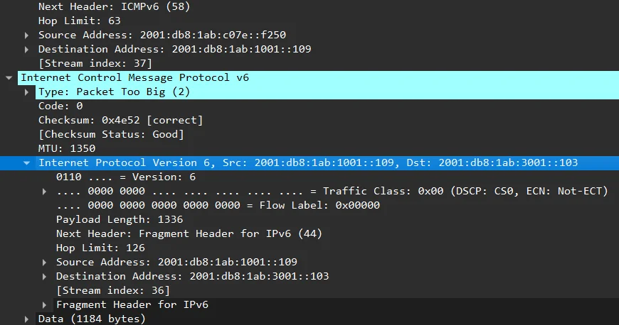

# CSIA 210 Network Protocol Analysis

Network Protocol Analysis was a term of reading traffic in Wireshark, chapter by chapter through a protocol-analysis textbook: addressing and headers, ICMP and IPv6 Neighbor Discovery, DHCP and DNS, TCP and UDP, IPv6 transition, scans and troubleshooting. A midterm and a final capstone tied it together.

## What the course provided and what was submitted {#what-the-course-provided}

The course provided the textbook's hands-on project steps, the trace files for every chapter after the first and for both capstones, the submission templates, and the capstone network diagrams. The submitted work:

- Installed Wireshark and made the first capture on his own computer
- Ran Windows network commands such as `arp`, `netsh` and `ping` for the early chapters
- Filtered the course's traces, expanded the packets each question asked about and wrote the answers
- Wrote a summary for each capstone lab

## Strongest work {#strongest-work}

### Final capstone: a lost IPv6 gateway {#final-capstone}

The final provided traces from a network with Windows hosts, DHCPv6 and a router sending router advertisements. The analysis matched a host's DHCPv6 address to the reply that assigned it, read the advertisement flags against the switch configuration, checked what stays readable in SSH and HTTPS (only banners and algorithm names), and followed one host through a duplicate address and a router lifetime that dropped from 270 seconds to 0 and back. The submitted summary: "This lab showed that IPv6 address state and IPv6 default gateway state are independent and a single RA can break IPv6 connectivity."

The full write-up is on [IPv6 packet investigations](../technical-labs/ipv6-packet-investigations.md).

### Midterm capstone: OSPF, Packet Too Big and DHCPv6 {#midterm-capstone}

The midterm traces came from a network running IPv4 and IPv6 side by side. Work across the nine labs:

- Built a combined filter for DHCP Discover messages from hosts that had no address yet (`0.0.0.0`)
- Found the OSPF hello packets and showed that IPv4 used OSPF version 2 and IPv6 used version 3
- Matched four routers and switches to their vendors and their IPv4 and IPv6 addresses
- Found ICMPv6 Packet Too Big messages and read the MTU they reported
- Followed a DHCPv6 lease and the server preference value, absent in one packet and 200 in the next
- Wrote a compound filter for one host's AAAA queries, which narrowed the trace to three packets

The Packet Too Big message is the router telling a sender that its packet didn't fit the next link. The outer header runs from the router back to the sender, and inside the message is the start of the original packet, so the sender can see which packet to shrink:

<figure class="evidence-figure">
  

    
  

  <figcaption>From the midterm submission, April 14, 2026, filtered with <code>icmpv6.type == 2</code> and cropped to the packet details. <a href="../../assets/evidence/csia-210/packet-too-big-2026-04-14.webp">Open full size</a>.</figcaption>
</figure>

### Recognizing scans in traffic (Chapter 12) {#recognizing-scans}

The chapter's three traces each held a different scan:

- **ARP scan:** one host sent broadcast "who has" requests across the subnet. The answer names the scanner and lists the ten hosts that replied.
- **Port scan:** "The port scan is obvious. If you look at every packet in the capture its SYN scanning multiple ports in a row starting at port 1." The target answered most probes with RST and ACK, and two ports were open: 2306 and 2310.
- **OS scan:** Statistics showed the top talkers, and decoding the reverse-DNS (PTR) queries gave back the addresses they asked about. The host that sent the queries was the likely attacker, and the address being looked up, `2001:db8:1ab:ba5e::109` in the IPv6 trace, was the likely target.

### A DHCP lease that ran out (Chapter 7)

In one trace a client tried to renew its lease with a unicast request and got no reply. When its timer ran out it broadcast the request to any DHCP server, and when that went unanswered too it dropped to `0.0.0.0` and started over with a Discover. The write-up follows each step and says what the client was doing at each one.

## Labs {#labs}

### Addressing, headers and ICMP

| Lab | What it asked | Work done |
|---|---|---|
| Chapter 1 | Install Wireshark, capture traffic and use filters | Captured live traffic and picked out the capturing computer's address and the broadcast address |
| Chapter 2 | Subnetting, IPv6 RFCs and the ARP table | Split a network into four /26 subnets of 62 hosts each, found the host's own IPv6 link-local address and watched an ARP entry return after a ping |
| Chapter 3 | Read IPv4, IPv6 and UDP header fields | Read each field, including the IPv6 traffic class split into DSCP and ECN |
| Chapter 4 | ARP, routes and routing-protocol packets | Captured the ARP cache and route table and expanded RIP, OSPF and EIGRP packets |
| Chapter 5 | ICMP packets and filters | Expanded ICMP packets and filtered ICMPv4 and ICMPv6 out of a trace |
| Chapter 6 | IPv6 Neighbor Discovery filters | Filtered each Neighbor Discovery message type, 133 to 136, and combined a type with a source address |

### DHCP, DNS and the midterm

| Lab | What it asked | Work done |
|---|---|---|
| Chapter 7 | DHCP and DHCPv6 exchanges | Matched a client identifier to its hardware address, listed the request's options and followed a lease renewal that failed (see above) |
| Chapter 8 | Host DNS settings and DNS queries | Captured the host's DNS settings, converted an IPv6 address to its literal form and expanded a DNS query |
| Midterm capstone | Nine labs on DHCP, DHCPv6, OSPF, device identification, IPv6 next headers, Packet Too Big and AAAA queries | Worked all nine (see above); one screenshot answer in Lab 2.2 is missing |

### Transport and IPv6 transition

| Lab | What it asked | Work done |
|---|---|---|
| Chapter 9 | UDP and TCP headers and the three-way handshake | Explained the ports, header lengths, acknowledgment numbers, and the MSS and window options in the handshake |
| Chapter 10 | ISATAP, 6to4 and Teredo traces | Expanded the transition headers in each trace and identified the ISATAP gateway and client |
| Chapter 11 | BGP looking glass and Windows transition interfaces | Queried a public BGP route server and listed the IPv6 transition interfaces on his own computer |

### Security, troubleshooting and IPv6 in practice

| Lab | What it asked | Work done |
|---|---|---|
| Chapter 12 | Recognize ARP, port and OS scans | Identified the scanner and the targets in each trace (see above) |
| Chapter 13 | Troubleshoot a website outage and a chatty host | Used Expert Information and I/O graphs to find bursts of TCP errors |
| Chapter 14 | IPv6 deployment traces | Filtered router advertisements and AAAA queries |
| Final capstone | Seven labs on application traffic, DHCPv6, router advertisement flags, SSH and HTTPS, duplicate addresses, SLAAC and router lifetime | Worked all seven (see above) |

## Skills {#skills}

- Wireshark display and capture filters (capstones, Chapters 1, 6, 12 and 14)
- Reading IPv4, IPv6, TCP and UDP headers (Chapters 3 and 9, midterm)
- DHCP and DHCPv6 leases, renewals, options and preference (Chapter 7, both capstones)
- IPv6 router advertisements, flags, router lifetime and SLAAC (Chapters 6 and 10, final capstone)
- OSPF, RIP and EIGRP packets (Chapter 4, midterm)
- ICMP and ICMPv6, including Packet Too Big (Chapters 5 and 6, midterm)
- DNS queries: A, AAAA and PTR (Chapters 8, 12 and 14, midterm)
- Recognizing ARP, port and OS scans from traffic (Chapter 12)
- IPv6 transition mechanisms: ISATAP, 6to4 and Teredo (Chapter 10)
- Troubleshooting with Expert Information and I/O graphs (Chapter 13)

## Limits {#limits}

- The trace files came from the course and aren't in the repository, so frame numbers can't be rechecked from it. Only the first capture is there.
- Chapters 4, 5, 6, 8, 10, 11, 13 and 14 are screenshots of the requested fields without written analysis.
- The work was reading the capstone networks' traffic, not building or repairing them.
- A few answers have mistakes: one final-capstone answer says a router advertisement's L flag is 0 while the next answer and the screenshot show it set, and the midterm explanation of the Packet Too Big addresses is muddled.
- Several chapters used his home network, so this page leaves out their addresses.

## Sources {#sources}

- [CSIA 210 repository](https://github.com/jkosber/CSIA-210-Network-Protocol-Analysis), with every submission above
- [Final capstone](https://github.com/jkosber/CSIA-210-Network-Protocol-Analysis/blob/main/Module08/CSIA%20210%20Finals%20Capstone%20submission%20file%20-%20Jadon%20Kosberg.docx)
- [Midterm capstone](https://github.com/jkosber/CSIA-210-Network-Protocol-Analysis/blob/main/Module04/CSIA%20210%20Midterm%20Capstone%20submission%20file%20-%20Jadon%20Kosberg.docx)
- [Chapter 12 scans](https://github.com/jkosber/CSIA-210-Network-Protocol-Analysis/blob/main/Module07/M07%20Chapter%2012%20Hands%20On%20Submission%20-%20Jadon%20Kosberg.docx)
- [Chapter 7 DHCP](https://github.com/jkosber/CSIA-210-Network-Protocol-Analysis/blob/main/Module04/M04%20Chapter%207%20Hands%20On%20Submission%20-%20Jadon%20Kosberg.docx)

[All coursework](index.md) · [IPv6 packet investigations](../technical-labs/ipv6-packet-investigations.md) · [NETI 109 Networking I](neti-109.md) · [CSIA 115 Cyber Ops](csia-115.md)
