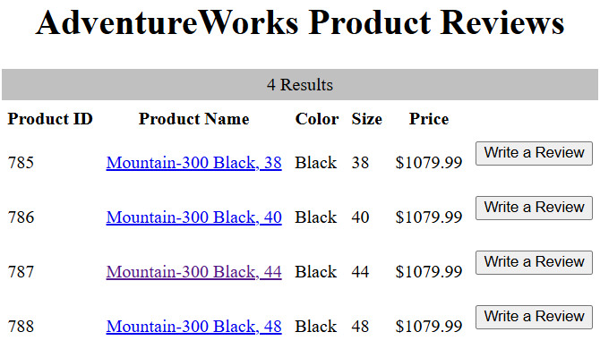

# AdventureWorks on AWS

This SVAD 111 project deployed the course's AdventureWorks product-review app on two Ubuntu servers in an AWS Academy lab: Apache and PHP on one, Microsoft SQL Server with the AdventureWorks catalog on the other. By the end the site searched the catalog, opened product pages and saved reviews to the database.

The course provided the app, the data, the two-server design and the install commands for each milestone. The submitted work covered launching the servers, running the installs, importing the data, connecting the two tiers, testing the app and writing the final report.

## Architecture and connection paths

<figure class="architecture">
  <ol class="architecture-flow" role="list">
    <li><strong>Browser</strong><span>Search catalog, open product, submit review</span><small>HTTP · TCP 80</small></li>
    <li><strong>Web instance</strong><span>Ubuntu 22.04<br>Apache + PHP 8.1<br>SQL Server PHP drivers</span><small>SQL connection · TCP 1433</small></li>
    <li><strong>Database instance</strong><span>Ubuntu 22.04<br>Microsoft SQL Server<br>AdventureWorks database</span><small>Catalog and review storage</small></li>
  </ol>
  <figcaption>The two EC2 instances, labeled by role instead of address. PuTTY and WinSCP connected to each over SSH for administration.</figcaption>
</figure>

The browser only talks to the web server. PHP connects to SQL Server through the database server's internal address in `config.php`, so the security-group rule, the database login and the PHP drivers all sit on the path every page request takes.

## Server setup

PuTTY handled the shells and WinSCP moved the course's archives onto the servers. The database server got Microsoft's signing key and package repository, SQL Server 2022 and the `sqlcmd` client, and a test query with Jadon's name ran against it. The web server got Apache, PHP 8.1 and Microsoft's ODBC driver and PHP extensions.

Each layer was checked before the next was built on it: row counts for the import, a `test.php` page for PHP, then the app's pages for the connection between the servers.

## Database and application configuration

### Adapting the data import for Linux

The course's data archive was built for Windows. Milestone 2B's steps converted the import script from UTF-16 to UTF-8, pointed it at the data folder, removed its `CODEPAGE` lines and changed the row terminator to match the data files' Windows line endings:

```bash
iconv -f UTF-16 -t UTF-8 instawdb.sql.orig > instawdb.sql
sed -i -e /CODEPAGE/d instawdb.sql
sed -i -e 's/\\n/\\r\\n/' instawdb.sql
```

Those are the milestone's commands; the submission shows the finished import rather than each step. Two counts in `sqlcmd` checked it:

```sql
SELECT COUNT(*) FROM Production.Product;
GO
SELECT COUNT(*) FROM Person.Person;
GO
```

They returned **504 products** and **19,972 people**.

### Connecting PHP to SQL Server

Next, the `sqlsrv` and `pdo_sqlsrv` extensions were enabled, Apache was set to the prefork module with the PHP module, and `test.php` showed PHP 8.1.2 under Apache. The app then went into `/var/www/html`, `config.php` got the database address and login, and Apache's default `index.html` was removed so the app's page loads first. Credentials and addresses are left out here.

## Troubleshooting

The final report lists four problems and what fixed them:

- **The web server timed out reaching the database.** The security group didn't allow SQL Server traffic; after a rule for port 1433 from the web server was added, the catalog loaded. In the report: "Connection Timed Out: The web server could not talk to the database."
- **The SQL login failed** even with the right password. Enabling SQL Authentication in the SQL Server setup fixed it.
- **Microsoft's packages weren't found.** Adding Microsoft's signing key and repository let the installs go through.
- **PuTTY couldn't reach EC2.** The network in use blocked outbound SSH, so the connection moved to a hotspot.

## Testing the result

| Check | Result |
|---|---|
| Row counts in `sqlcmd` | `Production.Product` 504, `Person.Person` 19,972 |
| `test.php` | PHP 8.1.2 running under Apache |
| Search with no term | 304 catalog results |
| Search for Mountain-300 | Four products, 785 to 788 |
| Open product 787 | Mountain-300 Black, 44, with its picture |
| Submit a review | The review appeared in the app with Jadon's name, a rating of 3 and "This is a good bike." |

<figure class="evidence-figure">
  <div class="evidence-scroll" role="region" tabindex="0" aria-label="AdventureWorks search results; scroll horizontally if needed">
    
  </div>
  <figcaption>The Mountain-300 search in the final report, May 8, 2026, cropped to the results. <a href="../../assets/evidence/aws/mountain-300-results-2026-05-08.png">Open full size</a>.</figcaption>
</figure>

## Limits and what to change {#scope-and-follow-up-ideas}

- Testing covered the import counts and the app actions above. Database integrity, load, recovery and whether reviews survive a restart weren't tested.
- The site ran on HTTP. The report recommended HTTPS, user accounts for reviewers and photo uploads; none of them were built.
- The milestone's instructions opened SSH and HTTP to any address and added rules for ports 1433 and 3306, and the last screenshot shows those four. The app only used SQL Server.
- The app connected as SQL Server's `SA` account, and the milestones trusted the database certificate for lab setup, so there's no least-privilege login or verified database TLS.
- `test.php` showed PHP's configuration, and the submitted files don't show it being removed.

A real deployment should restrict administration and database access first, give the app its own database login, remove the test page, add HTTPS and test recovery.

## Sources {#source-material}

- [Final report, May 8, 2026](https://github.com/jkosber/SVAD-111-Linux-Virtualization/blob/main/AdventureWorks%20Project%20-%20Jadon%20Kosberg.docx): screenshots, the problems and fixes, app tests and recommendations
- [Module 03 milestone](https://github.com/jkosber/SVAD-111-Linux-Virtualization/tree/main/Module03): the two EC2 instances
- [Module 05 milestones](https://github.com/jkosber/SVAD-111-Linux-Virtualization/tree/main/Module05): SQL Server install, the import and the query output
- [Module 07 milestones](https://github.com/jkosber/SVAD-111-Linux-Virtualization/tree/main/Module07): security-group rules, Apache and PHP, and the app tests

[SVAD 111 class page](../coursework/svad-111.md) · [All coursework](../coursework/index.md)
