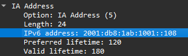

# IPv6 packet investigations

A Windows host can have an IPv6 address and still fail to reach another network. My CSIA 210 final capstone was about finding out why from the packets: which reply assigned an address, which hosts shared a duplicate, which source address a host picked, and what made a gateway disappear.

The course provided the traces, the network diagrams and the hosts' `ipconfig` output. I filtered the traffic, found the frames that explained each symptom, compared them with the host output and wrote up the conclusions.

## Environment and analysis method

The traces came from a network with Windows hosts, DHCPv6 and a layer 3 device sending router advertisements, with IPv4 running alongside. Every IPv6 address here uses the `2001:db8::/32` documentation prefix. These four filters did most of the work:

| Filter | What it shows |
|---|---|
| `dhcpv6.msgtype == 7` | DHCPv6 Reply messages, to find the one that assigned an address |
| `dhcpv6.iaaddr.ip == 2001:db8:1ab:1001::108` | Replies carrying the address the Windows host reported |
| `icmpv6.type == 134` | Router advertisements, with their flags, prefixes and router lifetime |
| `ipv6` | The wider IPv6 sequence, including address changes and neighbor discovery |

## Finding the DHCPv6 address assignment

The first question was which reply gave the Windows 10 host its address. I filtered for DHCPv6 replies and checked their IA Address options. Frame 9306 was the first reply carrying the host's address, ending in `::108`. Earlier replies carried `::109`, so the message type alone wasn't enough; the IA Address field is what tied the reply to the host.

<figure class="evidence-figure">
  

    
  

  <figcaption>Frame 9306's IA Address option in my May 12, 2026 submission, cropped to the address and its lifetimes. <a href="../../assets/evidence/networking/dhcpv6-address-lifetimes-2026-05-12.png">Open full size</a>.</figcaption>
</figure>

| Frame 9306 field | Value |
|---|---|
| Message type | Reply (7) |
| UDP ports | 547 to 546, server to client |
| Option | IA Address (5) |
| Address | `2001:db8:1ab:1001::108` |
| Preferred and valid lifetime | 120 and 180 seconds |

## Separating a duplicate address from general connectivity

In the second trace two Windows hosts were using the same address, ending in `::117`. I compared their source MAC addresses in the neighbor discovery traffic with the Windows output, which marked the address as a duplicate.

A normal ping still worked, over IPv4, with two replies. Forcing IPv6 failed. That forced attempt also showed a name-resolution error, so the duplicate flag and the neighbor discovery comparison are what point to the conflict, not the failed ping alone. In my summary: "With dual stack setup it fell back to IPv4 which worked but when you tried to force IPv6 pings it failed outright."

## Tracking source-address changes

Next I followed the Windows 10 host as it picked up public and temporary SLAAC addresses next to its DHCPv6 address:

| Point in the trace | What I found |
|---|---|
| Router advertisement | Managed flag set; on-link and autonomous prefix flags set |
| Frame 6913 | The host used its temporary SLAAC address as the source |
| Frame 7512 | A later advertisement with the autonomous flag off |
| Host output after that | Both SLAAC addresses deprecated; a later packet used the DHCPv6 address ending in `::117` |

I wrote at the time that the autonomous flag turning off deprecated the SLAAC addresses. That overstates it: an unset autonomous flag makes the host ignore that prefix information, and an address is deprecated when its preferred lifetime runs out ([RFC 4862, section 5.5.3](https://www.rfc-editor.org/rfc/rfc4862.html#section-5.5.3)). Pinning down the timing would take the full lifetime sequence from the trace.

## Losing the gateway while retaining the address

In the last trace the Windows host kept a preferred IPv6 address but lost its IPv6 gateway, and traffic to an off-link destination failed. I filtered router advertisements and lined up their router lifetimes with what the host did:

| Point in the trace | What happened |
|---|---|
| Frame 1 | A router advertisement with a 270-second router lifetime |
| Frame 9660 | The first of an earlier group of four pings |
| Frame 9725 | A router advertisement with lifetime 0; the host dropped its IPv6 default gateway |
| Host output | The IPv6 address stayed preferred; only the IPv4 gateway was listed |
| Frame 9887 | A new advertisement brought the 270-second lifetime back |
| Frame 9991 | The first ping of the later group, with connectivity restored |

A router lifetime of 0 removes that router as a default gateway, and a later advertisement with a nonzero lifetime adds it back ([RFC 4861, section 6.3.4](https://www.rfc-editor.org/rfc/rfc4861.html#section-6.3.4)). The DHCPv6 lease never supplied the gateway, which is why the address survived. My summary: "This lab showed that IPv6 address state and IPv6 default gateway state are independent and a single RA can break IPv6 connectivity."

## What remained visible in encrypted traffic

The same capstone looked at SSH (frames 27218 and 27364) and HTTPS (frames 27902 and 29910). Only the banners and algorithm names were readable; the application data wasn't. I didn't decrypt either session.

## Limits

- The traces aren't in the repository, so the frame numbers can't be rechecked from it. My screenshots show frame 9306, the router advertisement flags, the SSH frames and the first advertisement in the last trace; the other frame numbers come from my written answers.
- My submission doesn't include the host output I compared against for the `::108` match.
- I diagnosed the duplicate address but didn't fix it or retest.
- The SLAAC explanation above corrects what I wrote in the submission.

## Sources {#sources-and-scope}

- [Final capstone submission](https://github.com/jkosber/CSIA-210-Network-Protocol-Analysis/blob/main/Module08/CSIA%20210%20Finals%20Capstone%20submission%20file%20-%20Jadon%20Kosberg.docx): my answers and screenshots for Capstone Labs 3 and 4
- [CSIA 210 repository](https://github.com/jkosber/CSIA-210-Network-Protocol-Analysis), with the rest of the class's submissions

[CSIA 210 class page](../coursework/csia-210.md) · [All coursework](../coursework/index.md)
