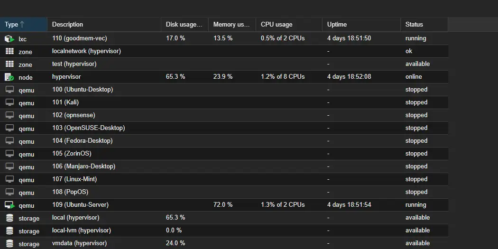
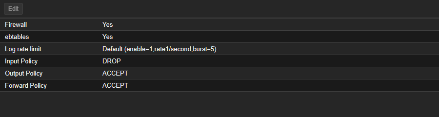

# Proxmox homelab

JHomelab was built on an old Alienware laptop to run a real hypervisor, Linux services and its own networks away from the daily-use computer. It's where the Linux, virtualization and networking from coursework turned into something that stays running.

Two service guests run all the time, and the other guests start only while they're being worked on. The apps on the service host are existing open-source projects; the work here is the infrastructure under them and keeping it patched and watched.

## How the lab fits together

<figure class="architecture">
  <ol class="architecture-flow" role="list">
    <li><strong>Physical connection</strong>Home router Wireless bridge Flat access network<small>Wired backhaul and VLANs planned</small></li>
    <li><strong>Proxmox host</strong>Alienware 15 R3 16 GB physical RAM SSD, guest-storage HDD and an unused NVMe<small>Virtual machines and two LXC containers</small></li>
    <li><strong>Guest attachments</strong>vmbr0: Ubuntu service VM + Debian LXC testnet: nine experimental VMs + Caddy pilot<small>Service migration to SDN planned</small></li>
  </ol>
  <figcaption>The lab as of October 23, 2026, with addresses left out.</figcaption>
</figure>

A range extender with its SSID hidden bridges the lab to the home router. Proxmox runs directly on the laptop and handles storage, guests and virtual networking. The access network is flat for now.

## Host and storage

The host runs **Proxmox VE 9.2.21** on kernel **7.0.14-25-pve**.

| Component | Use in the lab |
|---|---|
| Intel i7-7700HQ, four cores and eight threads | Compute shared by the virtual machines |
| 16 GB RAM | Physical memory for the host and running guests |
| 128 GB SSD | Proxmox and the `local` / `local-lvm` pools. It's aging, so Beszel watches its SMART data |
| 1 TB hard drive | `vmdata` storage for guest disks today; it becomes the backup drive once the NVMe is in use |
| NVMe SSD left over from Windows | Hidden from Proxmox by the BIOS's Intel RST RAID mode. Planned home for the guest disks |

The guests are assigned about 51.5 GB of memory in total, more than the laptop has. That's on purpose: only VM 109 and CT 110 start with the host.

## Linux guests and container services

The lab has **ten VMs and two LXC containers**. The experimental VMs are Ubuntu Desktop, Kali, openSUSE, Fedora, Zorin OS, Manjaro, Linux Mint and Pop!_OS, for trying a distribution without touching the daily-use computer, plus an OPNsense gateway still being built. CT 111, added in October, is a Caddy reverse-proxy pilot with internal HTTPS; Homepage was its first backend.

The services run in a full VM and an unprivileged container:

| Guest | Allocation and network | What it runs |
|---|---|---|
| VM 109, Ubuntu Server 26.04.1 LTS | 2 GB RAM, 32 GB disk; `vmbr0` | Docker host for the core services, deployed as a Portainer stack. Watchtower pulls new images for most of them once a day |
| CT 110, Debian 13.7 | Unprivileged LXC; 2 cores, 4 GB RAM, 512 MiB swap, 24 GB disk; `vmbr0` | GoodMem server v1.0.331 with PostgreSQL 17.11 and pgvector, in Docker inside the container |

### Services on VM 109

VM 109 runs Docker Engine 29.1.3.

| Service | What it does |
|---|---|
| Homepage 2.7.0 | The lab's dashboard, with live Proxmox, Portainer, Beszel and Uptime Kuma panels |
| Uptime Kuma 2.5.7 | Service checks, a status page on the home LAN and Discord alerts |
| Beszel 0.21.1 | Host and container health, drive SMART data and pending package updates |
| Portainer 2.45.3 | Container management |
| RustDesk Server 1.1.16 | Self-hosted remote support |
| Watchtower (maintained fork) | Daily image updates for Homepage, Uptime Kuma, Beszel and RustDesk |

<figure class="evidence-figure">
  

    
  

  <figcaption>The Proxmox inventory on September 22, 2026, before CT 111 existed. <a href="../../assets/evidence/homelab/guest-inventory-2026-09-22.webp">Open full size</a>.</figcaption>
</figure>

## Network configuration

Proxmox software-defined networking runs an experimental network next to the main LAN: zone `test` holds VNet `testnet`, and the lab guests attach to the VNet. VMs 100 to 108 and the CT 111 pilot are on it. Proxmox IPAM maps each VM to an address, dnsmasq handles DNS and DHCP, and a source-NAT rule on the host gives the network a way out. Each lab VM's address ends in its VMID, so the Proxmox inventory can be matched against packet captures and firewall logs at a glance. VM 109 and CT 110 are still on `vmbr0`.

### Firewall policy {#firewall-policy-and-its-limits}

The datacenter firewall is on, with seven accept rules for lab traffic, DNS and DHCP, and management access (ICMP, SSH and the Proxmox web interface). **Input defaults to DROP; output and forwarding default to ACCEPT.**

<figure class="evidence-figure">
  

    
  

  <figcaption>Datacenter firewall defaults on September 22, 2026. <a href="../../assets/evidence/homelab/firewall-options-2026-09-22.png">Open full size</a>.</figcaption>
</figure>

## Health check {#recorded-validation}

On September 22 a read-only check covered the host and services. It's the baseline later changes are compared against:

| Check | Result |
|---|---|
| Hypervisor | Core services active, no failed systemd units, web interface answering |
| VM 109 endpoints | Homepage and Uptime Kuma returned HTTP 200, Portainer HTTPS 200 |
| GoodMem | Docker health check healthy; the API answered |
| PostgreSQL with pgvector | Container running |
| Storage | All three pools active; the hard drive passed SMART with no reallocated, uncorrectable or CRC errors |

The check couldn't see inside VM 109, because its guest agent wasn't running and the SSH login was denied. Both were fixed in October: SSH works, and `qemu-guest-agent` now freezes the filesystem before snapshots and backups.

## October maintenance

### A certificate authority compromise

On October 21 the eMudhra (emSign) certificate authority had a key compromise, and Node.js, Python and uv shipped fixes. The `emSign ECC Root CA - G3` root was removed from the trust store on the Proxmox host and every guest. On CT 110 a snapshot came first, then updates to ca-certificates, OpenSSL, Docker, GoodMem and PostgreSQL. On VM 109 a snapshot preceded a Portainer update and a redeploy of every stack. Some vendors ship patched images late, so the response also included writing a small read-only script that checks each host and reports OK, WAIT, ACT or FAIL for every fix.

### Updates on every host

| Host | Work on October 23 |
|---|---|
| Proxmox host | Removed leftover Proxmox 8 (bookworm) APT entries and a duplicate security list, installed pending updates, and removed an old kernel while keeping the running kernel and two fallbacks |
| VM 109 | Installed the available updates, updated Portainer, Homepage and Uptime Kuma, installed `qemu-guest-agent`, and grew the root volume to the whole disk while the VM was running |
| CT 110 | Installed every pending update, 33 of them security fixes, and rebooted so every service loaded the new libc and systemd. GoodMem answered again 26 seconds later |

The original Watchtower project was archived in December 2025, and it only worked on Docker 29 because of a pinned older API version. The maintained fork replaced it; the fork negotiates the API itself, so the pin is gone. A snapshot or backup preceded each change and was deleted once everything checked out.

### Monitoring and alerts

Before October, Uptime Kuma was installed but never set up, and nothing watched the hardware. Now Beszel agents on the host, VM 109 and CT 110 track the machines, and Uptime Kuma checks the services from outside every minute. Both post to a private Discord channel.

| Alert | From | Fires when |
|---|---|---|
| Machine down | Beszel | A host or guest stops reporting for 2 minutes |
| Resources | Beszel | CPU or memory stays above 90% for 10 minutes, or a disk passes 85% |
| Drive health | Beszel | A drive's SMART state gets worse |
| Services and containers | Beszel | A systemd service fails or a Docker health check goes unhealthy |
| Heat | Beszel | The laptop runs above 85 °C for 5 minutes |
| Service down | Uptime Kuma | Two failed checks in a row on Proxmox, GoodMem, Portainer, Beszel, RustDesk or this site |
| Certificate | Uptime Kuma | This site's TLS certificate is close to expiring |

Beszel also lists pending package updates and flags the security ones. The first time it ran, it showed 87 waiting on CT 110.

### Dashboard

Homepage was installed but never configured. Before setup, it was compared with Homarr, Dashy, Glance, Homer, Heimdall and four Proxmox-specific dashboards. Homepage won because it pulls live data from all four tools in the lab, it's widely used, and its current image runs a patched Node version. Homarr came close but can't show Portainer.

Each panel has its own credential instead of the admin logins. The Proxmox panel uses an API token on a separate user with only the `PVEAuditor` role, and a write attempt with it got a 403. Portainer has an access token made for the dashboard, and Beszel has a separate superuser account, because Homepage's Beszel panel needs one. Homepage reads them from root-only files mounted read-only, so none of them sit in the dashboard config.

## GPU passthrough preparation

The laptop has a GTX 1070 Mobile next to its integrated graphics. IOMMU is enabled with `intel_iommu=on iommu=pt pcie_acs_override=downstream`, and the NVIDIA GPU is bound to `vfio-pci` and assigned to VMs 100, 105, 107 and 108.

## Lessons learned {#what-i-have-learned}

- Installed isn't the same as monitored. Uptime Kuma was on VM 109 well before it checked anything.
- Targeted fixes aren't patching. CT 110 got only hand-picked fixes, and 87 updates piled up until Beszel showed them.
- Tools the lab depends on can quietly stop being maintained. Watchtower had been archived for ten months, and it only kept working because of a pinned older Docker API.

## Limits

- The firewall is untested with live guest traffic: no guest DHCP, egress or blocked-traffic test yet. The diagram shows how things connect, not a tested security boundary.
- The September check didn't cover recovery, restoring a backup, database integrity or certificate trust (its HTTPS probes accepted self-signed certificates).
- The GPU hasn't been tested inside a guest yet.
- Beszel and Uptime Kuma both run on VM 109, so nothing sends an alert if the whole host goes down.
- Portainer actions and the Uptime Kuma interface are untested beyond the monitors.

## Next changes

Storage comes first: switch the BIOS to AHCI, move the guest disks onto the NVMe and start scheduled backups to the 1 TB drive. Then an off-host alert for when the Proxmox host goes down, and moving the Tailscale subnet router from VM 100 to the always-on VM 109.

The September check also turned up three firewall fixes due before the network expands: one rule's comment says internet access while its destination is the home LAN, the legacy firewall status reports pending changes while nftables is active, and global IPv4 forwarding is `0` while `vmbr0` and `testnet` have it on. After that comes a test of the policy with real guest traffic.

Further out: a Cat6 run to replace the wireless bridge, a managed switch with 802.1Q VLANs, SDN for the service guests, per-zone firewall rules, a reverse proxy for internal hostnames (Caddy on CT 111 first, before Nginx Proxy Manager), internal DNS, a NAS, Wazuh or Security Onion for SIEM and IDS, Jellyfin with GPU transcoding, and finishing the OPNsense gateway.

## Sources {#sources-and-artifacts}

- [Build journal and inventory, October 23 revision](https://github.com/jkosber/JHomelab/blob/b5a5608e6580e5420beb3672b65e67629953814a/README.md): host, storage, guests, services, monitoring, SDN and roadmap
- [October 2026 maintenance notes](https://github.com/jkosber/JHomelab/blob/b5a5608e6580e5420beb3672b65e67629953814a/docs/maintenance-2026-10-23.md): the certificate authority response, updates, monitoring, dashboard and the storage finding
- [Read-only health check, September 22](https://github.com/jkosber/JHomelab/blob/b5a5608e6580e5420beb3672b65e67629953814a/docs/health-check-2026-09-22.md): results, access limits and storage warnings
- [Guest inventory](https://github.com/jkosber/JHomelab/blob/b5a5608e6580e5420beb3672b65e67629953814a/screenshots/guest-inventory-2026-09-22.webp) and [firewall options](https://github.com/jkosber/JHomelab/blob/b5a5608e6580e5420beb3672b65e67629953814a/screenshots/firewall-options-2026-09-22.png) screenshots

The repository holds documentation and screenshots. Sanitized configuration exports, firewall rules and Compose files go in once they stop changing every week.

[All projects](index.md) · [SSH Workbench](ssh-workbench.md) · [AdventureWorks on AWS](aws-linux-infrastructure.md)
